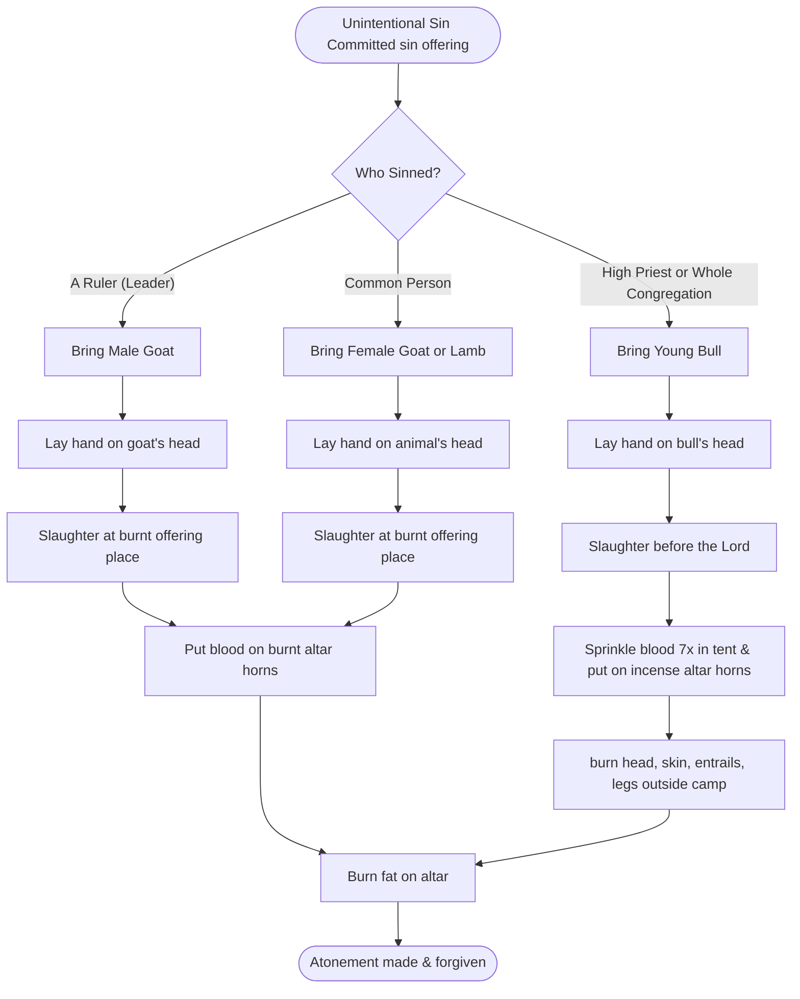

# Leviticus 4 (LSB)
#biblestudy/devotionals/leviticus

> ### The Statutes of Sin Offerings
> **Lev. 4:1**   Then Yahweh spoke to Moses, saying, **2** “Speak to the sons of Israel, saying, ‘If a person sins ==unintentionally== in any of the things which Yahweh has commanded not to be done, and he does any one of them, 

[[(ESV) 1 Timothy|test]] [title](address)
> **3** if the anointed priest sins so as to bring guilt on the people, then let him bring near to Yahweh a bull from the herd without blemish as a sin offering for the sin he has committed. **4** ‘Then he shall bring the bull to the doorway of the tent of meeting before Yahweh, and he shall lay his hand on the head of the bull and slaughter the bull before Yahweh. **5** ‘Then the anointed priest shall take some of the blood of the bull and bring it to the tent of meeting, **6** and the priest shall dip his finger in the blood and sprinkle some of the blood seven times before Yahweh in front of the veil of the sanctuary. **7** ‘The priest shall also put some of the blood on the horns of the altar of fragrant incense which is before Yahweh in the tent of meeting; and all the blood of the bull he shall pour ==out at the base of the altar== of burnt offering which is at the doorway of the tent of meeting. **8** ‘Then he shall raise up from it all the fat of the bull of the sin offering: the fat that covers the entrails and all the fat which is on the entrails, **9** and the two kidneys with the fat that is on them, which is on the loins, and the lobe of the liver, which he shall remove with the kidneys **10** (just as it is raised up from the ox of the sacrifice of peace offerings), and the priest shall offer them up in smoke on the altar of burnt offering. **11** ‘But the hide of the bull and all its flesh with its head and its legs and its entrails and its refuse, **12** that is, all *the rest of* the bull, he shall bring out to a clean place outside the camp where the ashes are poured out, and he shall burn it on wood with fire; where the ashes are poured out it shall be burned.
> 
> **Lev. 4:13**   ‘Now if the whole congregation of Israel commits error, and the matter is hidden from the sight of the assembly, and they commit any of the things which Yahweh has commanded not to be done, and they become guilty; **14** when the sin which they have committed becomes known, then the assembly shall bring near a bull from the herd for a sin offering and bring it before the tent of meeting.

The requirement of this law is that the **assembly** was not aware of the sin. If they were, they would be accomplices in this sin and have no right to bring and offer the bull on behalf of the congregation. 

> **15** ‘Then the elders of the congregation shall lay their hands on the head of the bull before Yahweh, and the bull shall be slaughtered before Yahweh. **16** ‘Then the anointed priest shall bring some of the blood of the bull to the tent of meeting; **17** and the priest shall dip his finger in the blood and sprinkle *it* seven times before Yahweh in front of the veil.

The priest had to do this with his hands. He would not be able to wash his hands clean off of this sacrifice like Pilate thought he had #todo/opzoeken/reference #todo stukje schrijven met uitleg over betekenis vanhanden wassen. Even if the priest had not sinned himself, he had to have the attitude like that of Jeremiah #todo/opzoeken/bible who said "they all" had sinned and who petitioned not on behalf of the people, but on behalf of himself *and* the people. #biblestudy/discovery
So the priest dirtied his hands and had to admit his fault in all matters. In a sense this is true. If man's son sins, for example, it is not directly the father's fault but it is partially due to his upbringing of the child, and his lack of teaching or prayer for the child. There is not a father in this world with a sinning son who can say that he has done all he could to bring his child to Christ and to have done so in a perfect way.

> **18** ‘And he shall put some of the blood on the horns of the altar which is before Yahweh in the tent of meeting; and all the blood he shall pour out at the base of the altar of burnt offering which is at the doorway of the tent of meeting. **19** ‘He shall then raise up all its fat from it and offer it up in smoke on the altar. **20** ‘He shall also do with the bull just as he did with the bull of the sin offering; thus he shall do with it. So the priest shall make atonement for them, and they will be forgiven. **21** ‘Then he shall bring out the bull to *a place* outside the camp and burn it as he burned the first bull; it is the sin offering for the assembly.
> 
> **Lev. 4:22**   ‘When a leader sins and unintentionally does any one of all the things which Yahweh his God has commanded not to be done, and he becomes guilty, **23** or if his sin which he has committed is made known to him, he shall bring for his offering a goat, a male without blemish.

It seems as if two situations are described here which require the **leader** to make an **offering**—when **he becomes guilty** or when **his sin [...] is made known to him**. The latter one is obvious, as soon as the leader knows he sinned, he needs to offer **a goat**. The former one is less intuitively obvious, for the leader becomes guilty as soon as he has committed the crime, regardless of whether the sin is made known to him. Furthermore, both situations do not describe the leader's feeling of guilt—he needs to bring the offering regardless of his own feelings. 
It is the same with children. When they have done something wrong, they need to apologize regardless of their feelings, because it is an admission of having done something wrong. Even if the child only understands on an intellectual level that what he did was wrong, it is still necessary that he admits it. Needless to say, the payment for the wrongdoing needs to happen as well, for the same reason. #biblestudy/discovery 

> **24** ‘Then he shall lay his hand on the head of the male goat and slaughter it in the place where they slaughter the burnt offering before Yahweh; it is a sin offering. **25** ‘Then the priest shall take some of the blood of the sin offering with his finger and put it on the horns of the altar of burnt offering; and *the rest of* its blood he shall pour out at the base of the altar of burnt offering. **26** ‘And all its fat he shall offer up in smoke on the altar as *in the case of* the fat of the sacrifice of peace offerings. Thus the priest shall make atonement for him in regard to his sin, and he will be forgiven.
> 
> **Lev. 4:27**   ‘Now if anyone of the common people sins unintentionally in doing any of the things which Yahweh has commanded not to be done, and becomes guilty, **28** or if his sin which he has committed is made known to him, then he shall bring for his offering a goat, a female without blemish, for his sin which he has committed. **29** ‘And he shall lay his hand on the head of the sin offering and slaughter the sin offering at the place of the burnt offering. **30** ‘And the priest shall take some of its blood with his finger and put it on the horns of the altar of burnt offering; and all *the rest of* its blood he shall pour out at the base of the altar. **31** ‘Then he shall remove all its fat, just as the fat was removed from the sacrifice of peace offerings; and the priest shall offer it up in smoke on the altar for a soothing aroma to Yahweh. Thus the priest shall make atonement for him, and he will be forgiven.
> 
> **Lev. 4:32**   ‘But if he brings a lamb as his offering for a sin offering, he shall bring it, a female without blemish. **33** ‘And he shall lay his hand on the head of the sin offering and slaughter it for a sin offering in the place where they slay the burnt offering. **34** ‘And the priest shall take some of the blood of the sin offering with his finger and put it on the horns of the altar of burnt offering, and all *the rest of* its blood he shall pour out at the base of the altar. **35** ‘Then he shall remove all its fat, just as the fat of the lamb is removed from the sacrifice of the peace offerings, and the priest shall offer them up in smoke on the altar, on the offerings by fire to Yahweh. Thus the priest shall make atonement for him in regard to his sin which he has committed, and he will be forgiven.

